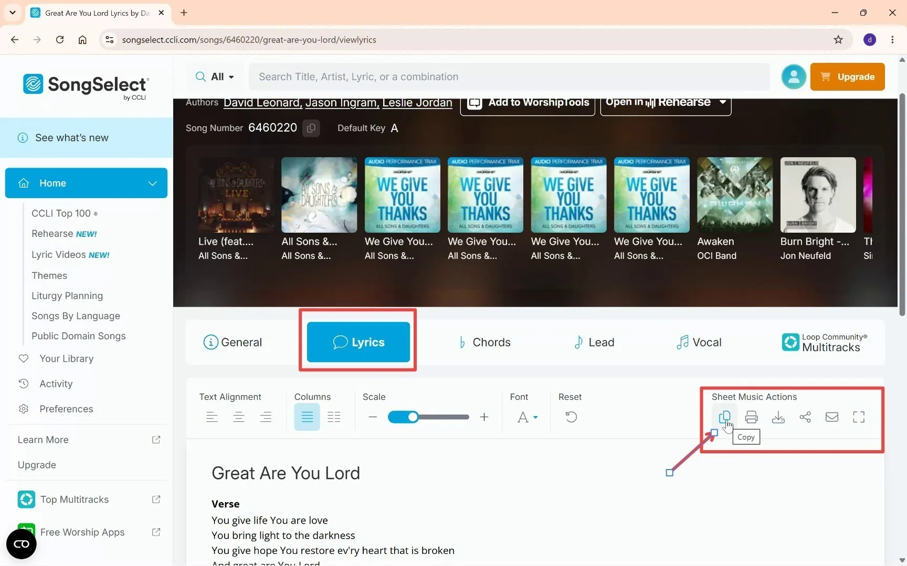
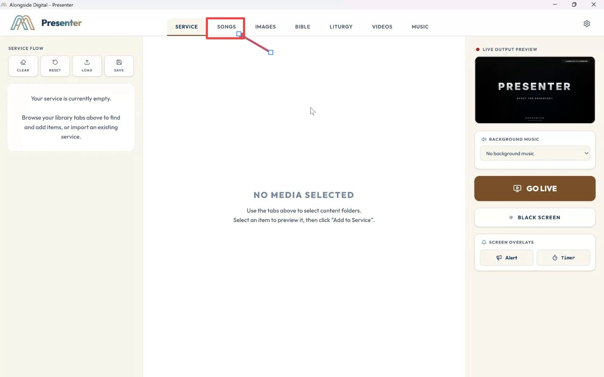
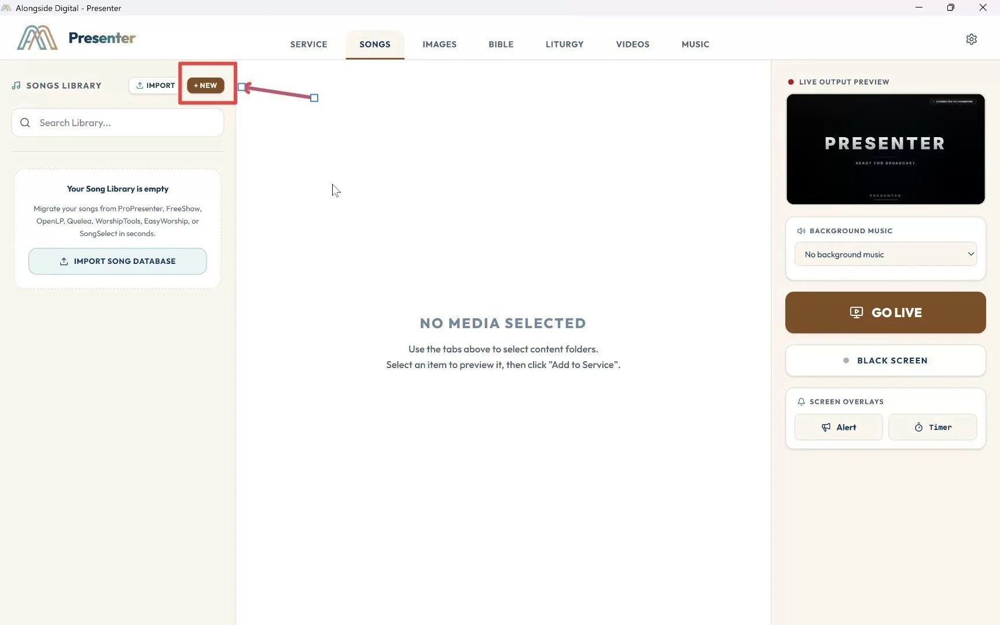
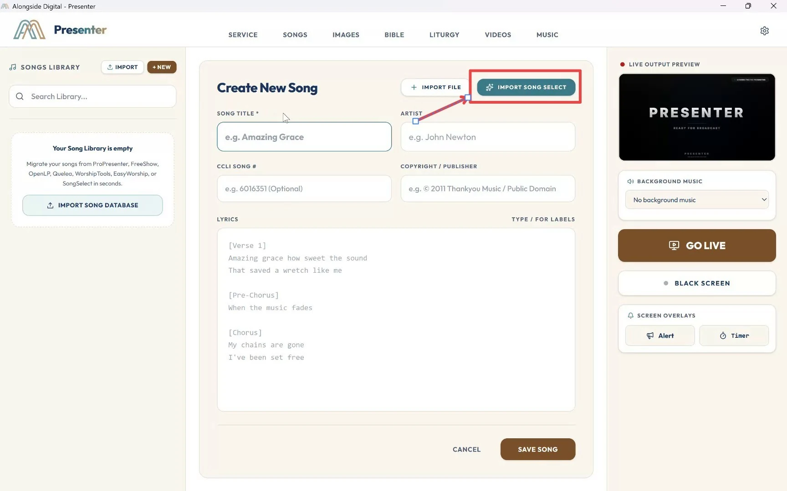
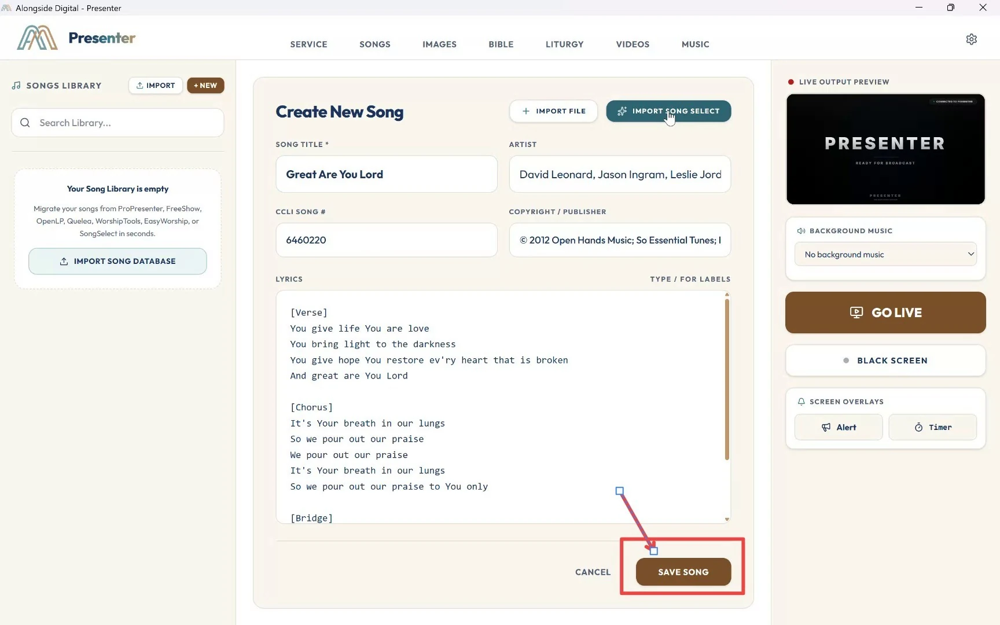
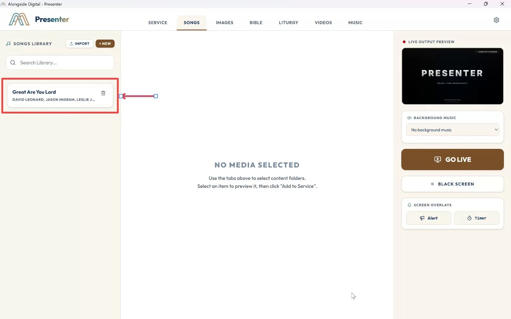

Presenter allows you to manage a fast, searchable local database of worship songs, hymns, and contemporary anthems — complete with full-text lyric search, section arrangements, on-screen CCLI attribution, and automated CCLI reporting.

:::tip[Moving from ProPresenter, FreeShow, OpenLP, Quelea, or WorshipTools?]
You can bring your entire existing song database into Presenter in minutes using the **Universal Song Library Importer**. See **[Importing Your Song Library](/presenter/importing-songs)** for supported software and step-by-step instructions.
:::

---

## 1. Adding a Song from CCLI SongSelect to Your Library

Follow these 6 steps to copy official lyrics and metadata from the **CCLI SongSelect** website directly into Presenter.

### Step 1: Copy SongSelect Lyrics
To add a song from **SongSelect**, first find the song within the **[CCLI SongSelect website](https://songselect.ccli.com)**, navigate to the **Lyrics** tab, and click the **Copy** button under **Sheet Music Actions**.

---

### Step 2: Select Songs in Presenter
Next, within the **Presenter** application, click on **Songs** along the main Library navigation bar at the top of the screen.

---

### Step 3: Click + New
In the left-hand **Songs Library** navigation panel, click the **+ New** button to add a new song to your library.

---

### Step 4: Click Import Song Select
In the **Create New Song** screen, click the **Import Song Select** button at the top right.

---

### Step 5: Review & Save Song
The **Song Title**, **Artist**, **CCLI Song #**, **Copyright / Publisher** information, and **Lyrics** will automatically be filled out, with the song cleanly broken into its required sections (`[Verse]`, `[Chorus]`, `[Bridge]`).

To finish adding the song to your library, click **Save Song** at the bottom right.

---

### Step 6: Song Added to Your Library
Your newly added song will now appear in the left-hand **Songs Library** panel, ready for you to select and add to your services. See **[Adding Songs & Building Your Service Flow](/presenter/service-flow)** for the next step.

---

## 2. Adding a Song Manually

If a hymn, original church composition, or chorus isn't on SongSelect, you can add it manually in seconds:

1. Click the **Songs** tab on the top navigation bar, then click **+ New** in the left-hand **Songs Library** panel.
2. Fill in **Song Title \*** (required), plus optional **Artist**, **CCLI Song #**, and **Copyright / Publisher** fields.
3. Type or paste your lyrics into the **Lyrics** editor, separating sections with square-bracket labels such as `[Verse 1]`, `[Pre-Chorus]`, `[Chorus]`, `[Bridge]`, `[Tag]`, or `[Outro]`.
   * **Quick Slash Shortcuts:** Type `/v1`, `/v2`, `/c`, `/pc`, `/b`, or `/o` on a new line to insert formatted section labels instantly.
4. Click **Save Song** at the bottom right. Presenter saves it as a clean Markdown file inside `Presenter\Songs\`.

---

## 3. Editing Songs & Quick Fix

* **Full Song Edit:** Select any song in your **Songs Library** and click **Edit Song** in the preview toolbar to update its title, artist, copyright line, CCLI number, or full lyrics.
* **Slide Quick Fix:** Spotted a typo right before the service? Click **Quick Fix** directly beneath any individual slide tile in the preview pane to correct it on the spot without opening the full editor.

---

## 4. Flow Arrangement & Lines Per Slide

* **Lines Per Slide (`1`, `2`, `3`, `4`):** Use the **Lines** selector at the top of any song preview to switch dynamically between 1, 2, 3, or 4 lines per slide—without ever rewriting or re-splitting your lyrics.
* **Flow Arrangement:** Click **Flow Arrangement** to build custom verse/chorus orders (for example `Verse 1 → Chorus → Verse 2 → Chorus → Bridge → Chorus → Outro`) without duplicating lyric text in your file.

---

## 5. Bulk Importing Downloaded SongSelect Files (`.txt` or `.usr`)

If you have downloaded multiple **Lyrics (`.txt`)** or **USR (`.usr`)** files from CCLI SongSelect:

1. In Presenter, open the **Songs** tab and click **Import** next to **+ New** (or drag and drop the downloaded `.txt` / `.usr` files anywhere onto the Presenter window).
2. Presenter automatically extracts the song title, authors/writers, copyright notice, CCLI song number, and `[Verse]` / `[Chorus]` sections for every file.
3. Click **Import Songs** to save them all to your library at once.

For migrating full song databases from ProPresenter, FreeShow, OpenLP, Quelea, WorshipTools, EasyWorship, or OpenSong, see **[Migrating a Song Database](/presenter/importing-songs)**.

---

## 6. CCLI Copyright Display & Annual Reporting

To enter your church's **CCLI Licence Number**, choose where attribution credits appear on screen (**First Slide Only**, **Last Slide Only**, etc.), or export your annual **Song History CSV**, see **[CCLI Licensing & Annual Reporting](/presenter/settings-ccli)**.
